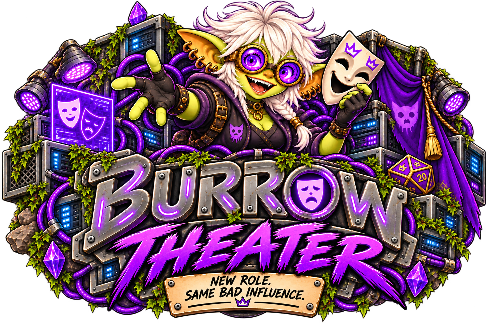

<p align="center">
  
</p>

# Burrow Theater

**New role. Same bad influence.**

Burrow Theater is an optional lightweight roleplay mod that keeps Burrow's familiar conversation experience while removing the operational machinery.

A Theater conversation is deliberately small:

```text
SOUL role + conversation transcript → selected text model → reply
```

The role is defined with the same SOUL-style Markdown used by Burrow agents. Theater does not provide tools, workspace context, task state, Brains, handoffs, subagents, or runtime-proof behavior. It uses Core's configured text models directly with `tools: null` and stores its roles and conversations only in the mod's Core-namespaced settings.

## Current experience

- Familiar Burrow-style chat and composer
- Reusable SOUL roles and a Theater-specific operator profile managed through Burrow Settings
- Rename, archive/restore and permanently delete conversations when no work is pending
- Optional Forge images enabled independently for each role when Core has an image model available
- Configured model selection, including local text-only models
- Persistent conversations with immediate operator-message feedback and Core-backed durable text-generation reconciliation
- Explicit fiction boundary with no operational agent behavior
- Responsive desktop and mobile layouts

## User guide

Start with the [Theater guide](docs/guide/index.md) for roles, group conversations, Forge images, and current limits.

## Development

Requires Node.js 22.13+ and a sibling `Burrow-Backend` checkout for the Core contract test.

```sh
npm run build
npm test
```

Install through **Settings → Mods → Mod sources**:

1. Add `https://github.com/GoblinKing-Burrow/Burrow-Theater.git`.
2. Refresh and install a tagged version.
3. Explicitly enable the mod.

Burrow Theater is distributed under the [Burrow Sustainable Use License](LICENSE).


### Generation prompt limits and recovery

The assembled SOUL, player profile, cast, and transcript must fit Core's
100,000-UTF-16-unit generation prompt limit. Theater rejects an oversized new
turn with `generation_prompt_limit` (HTTP 413) before saving it; it does not
silently truncate authored context. Start a new conversation or reduce the
profile/SOUL context. Existing oversized pending turns settle as failed on
reconciliation, unlocking conversation deletion and role edits. A later
cast member's oversized prompt fails the group turn without publishing partial
replies. Ambiguous admission failures retain the same idempotency key for retry.

